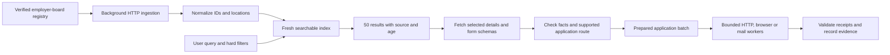

# ApplyBurst: architecture decision, 16 October 2026

The default product is a CPU-only job index plus a deterministic application executor. An ordinary laptop needs no model, GPU, n8n instance, or browser agent to search. A browser is started only for applications that need a website session.

The defensible first promise is **“Find 50 matching indexed jobs in seconds.”** The eventual application promise must specify supported sites and measure confirmed receipts. Fifty discovered jobs, fifty queued tasks, fifty filled forms, and fifty employer-confirmed applications are separate outcomes.

## 1. Find jobs without putting crawling on the search path

**Use public structured ATS feeds first.** Greenhouse, Lever, and Ashby are implemented. One board response can contain hundreds of jobs. LinkedIn/JobSpy is a supplemental discovery source, isolated from interactive search. Our single JobSpy probe returned only 20/50 results after a rate-limit warning; it cannot carry the latency guarantee.

**Keep a registry.** These ATS feeds are company-specific; they are not global search APIs. The baseline registry contains nine explicitly identified boards, including four Turkish employer boards. It is a seed, not broad job-market coverage. Expand it offline from company career links, existing public registries, and archive indexes, then validate each live board. Handle company migrations and regional ATS hosts; a stale slug is not proof a company has no vacancies.

**Publish results as sources finish.** The index is queryable while refresh tasks are pending. The refresh report records time to the first 50 indexed jobs, time to 50 title-query matches, and completion of all sources separately. An eight-second request deadline bounds an individual slow source. A slow or failed source must not delay cached search, erase its previous snapshot, or make old data appear newly verified.

**Fetch only what the decision needs.** Greenhouse metadata is the default; hydrate job descriptions and application questions only for selected jobs. The observed Stripe response with descriptions was 12.46 times the decoded size of metadata alone. Other feeds can include descriptions unconditionally; normalize them but do not run a model over every posting.

**Cache with correctness.** Store provider, board, external ID, source URL, observed time, active state, and provider revision headers. Conditional refresh uses ETag/Last-Modified; identical content hashes skip index rebuilding. Remove disappeared jobs only after a complete successful board snapshot. Exclude stale rows from normal search. A recent observation is distinct from the original posting date.

**Do not count duplicates as jobs.** The implemented primary key is `(provider, board, external_id)`. Before mixing LinkedIn and employer feeds, add canonical ATS link resolution and cross-source alias records. Preserve distinct requisitions, locations, and application destinations; title/company equality alone is insufficient for merging. Cross-source merging is not implemented yet.

## 2. Matching without generative inference

The baseline uses SQLite FTS5 prefix search. The CLI defaults to title matching, with full-text search optional. Add deterministic location, employment type, seniority and skill filters before any semantic reranking. Keep missing facts as unknown. A “remote” label does not establish worldwide work eligibility, and “Hybrid” alone does not establish a country.

Cheap ranking order: exact terms and synonyms → BM25 → optional small static embeddings or a trained classifier over a shortlist. Encode each changed job once in the ingestion worker if embeddings prove useful. Never use a 50-request LLM loop to rank 50 results.

Count search quality as well as latency: unique results, freshness, relevant titles, geographic constraints, supported application destinations, and recall against a manually reviewed target list. Our public probes demonstrate retrieval throughput, not personal fit or market-wide recall.

## 3. Apply through the cheapest verified route

Resolve each selected job to a capability record before promising it is ready:

| Route | Execution | What must be known |
| --- | --- | --- |
| Documented submission API | Pooled HTTP requests | Applicant-usable credentials and complete required fields |
| Known hosted form | Reusable browser workflow | Session, upload behavior, schema version and confirmation condition |
| Explicit application email | Mail transport and a rendered template | Verified application address, approved content and delivery state |
| Unknown form or question | Collect schema and request missing facts | A tested adapter or reviewed new mapping |

Public listing APIs do **not** imply public applicant submission APIs. Greenhouse and Lever document employer-side authentication for their POST endpoints. The application baseline therefore uses a local receiver; it does not claim those endpoints are universally available to job seekers. See the [Greenhouse](https://docs.greenhouse.io/job-board.html) and [Lever](https://github.com/lever/postings-api#apply-to-a-job-posting) documentation.

For a known form, extract labels, types, options, required fields and upload requirements. Match them to approved candidate facts and an answer bank. Cache the schema-to-profile mapping, not candidate values or session tokens. Invalidate on required-field/type/option changes. A classifier may eventually help identify an unfamiliar field; it cannot supply an unknown visa, salary, consent or work-authorization answer.

Run one browser process with **two reusable contexts by default** on laptops. Benchmark higher concurrency separately. HTTP workers can be more numerous, but concurrency and request-start rate are separate controls. Respect a provider's actual limit scope. A single 2-POST/second bucket requires at least 24.5 seconds to start 50 requests, before the final response; parallel tabs cannot remove that bound. Lever documents a 2-POST/second limit for custom job sites; the baseline includes a separate paced fixture run rather than hiding this constraint. [Lever rate-limit documentation](https://github.com/lever/postings-api#post-application-rate-limit).

Use explicit readiness checks instead of unconditional sleeps. Upload prevalidated documents. Wait for a provider-specific confirmation, not just a button click or HTTP 200. Persist claims before sending; deduplicate by candidate and canonical job. A timeout after a possible side effect becomes `unknown` and needs reconciliation. Do not blindly retry it. The baseline ledger implements persistent claims, conservative unknown outcomes and explicit recovery of interrupted work; it is not a distributed exactly-once queue.

For email, a template can produce useful tailored mail from known company, role and candidate facts without any model. Generative rewriting is optional and outside the submission path. SMTP acceptance means the mail server accepted the message; it does not prove inbox delivery, recruiter review, or an ATS application.

## 4. Deployment that fits laptops

Offer two implementations of the same interfaces:

- **Hosted index plus local session executor:** shared ingestion and indexing run once; the laptop uses a lightweight web UI and a local browser extension/helper for authenticated forms. Candidate/session data stays in the local execution boundary where practical. Remote index access does not require local GPU hardware.
- **Self-hosted/local mode:** the existing Python CLI and SQLite index run on a laptop, refreshing only selected boards. Do not crawl the entire market separately for every user. A compressed index snapshot plus incremental updates is a later distribution option.

Keep components as Python libraries plus a small API; orchestration is ordinary async code. SQLite is sufficient for the baseline. Move the shared service to Postgres plus a durable worker queue only when multi-user load or operational requirements justify it. UI, CLI and future extension call the same discovery/preparation/execution contracts. No n8n dependency is present.

## 5. What is built and what remains

Implemented: three ATS normalizers; a nine-board registry; bounded concurrent ingestion; per-source deadlines; incremental visibility; ETag/Last-Modified and content-hash refresh; FTS search with freshness; local multipart submission and browser replay fixtures; real local SMTP transport; a persistent application ledger; raw benchmark reports; failure-path tests.

Not implemented: global board discovery; cross-source deduplication; geographic eligibility evaluation; real employer submission adapters; production form-plan storage/invalidation; authenticated browser-session management; personalized mail drafts; a public application service or hosted demo. There is no model dependency or completed model benchmark. An attempted model experiment was stopped when the user prioritized discovery and reserved their GPU for training.

Next sequence: expand and measure discovery coverage → validate one real hosted-form adapter with reviewed test data → validate more form families and the mail path → build/publish the demo on those measured capabilities. Public “50 applications in seconds” copy waits for actual evidence on that supported set.
